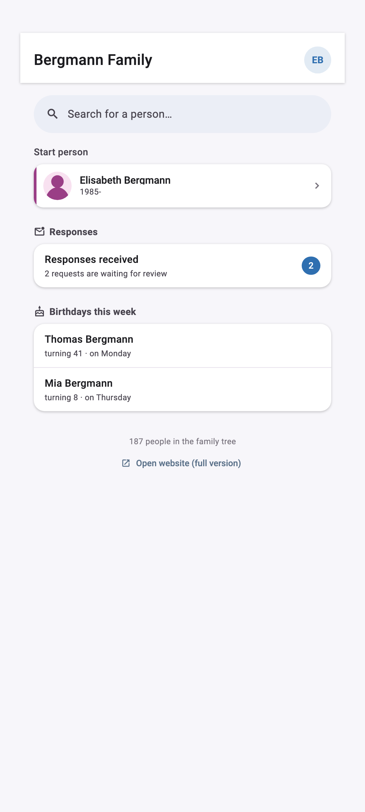
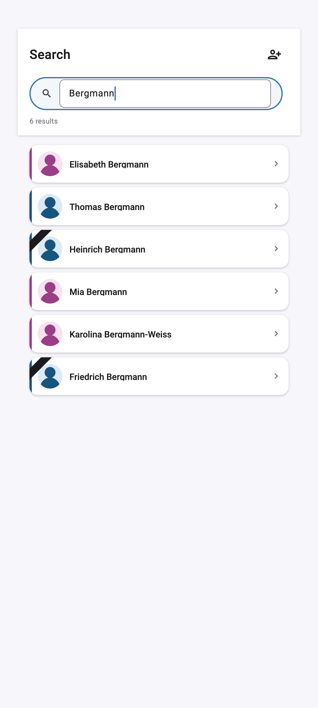
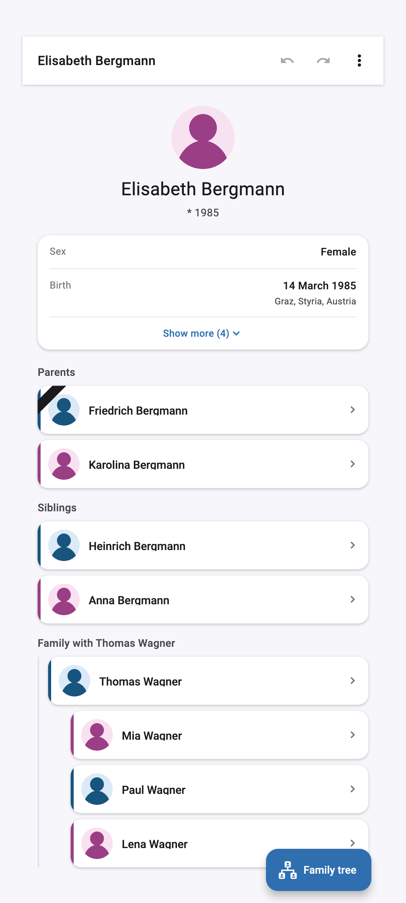
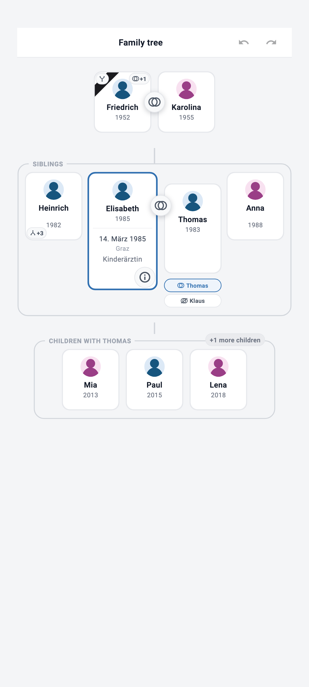
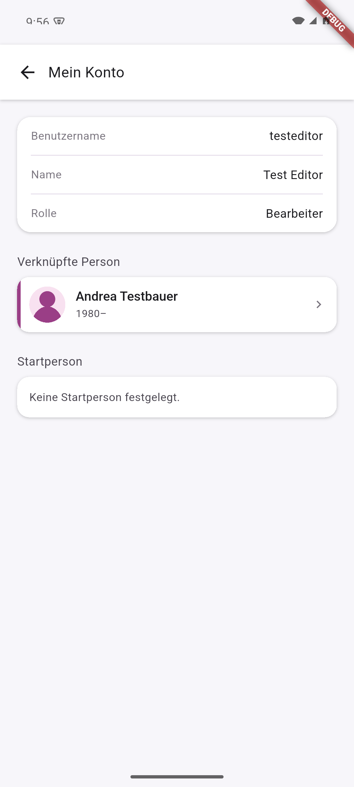

# webtrees-mobile

Android & iOS app for [webtrees](https://webtrees.net) sites, developed with Flutter. It needs the [api4webtrees](https://github.com/thobgg/api4webtrees) module on the server.

## Why this app

There are other apps for webtrees. This one deliberately does not try to cover everything webtrees can do – and it won't in the future either. webtrees in the browser stays the best place for genealogists to record and catalogue everything properly.

The app is for families who build their family tree together, extend it and keep it alive. It keeps things simple, so that everyone – beginner or expert – can use it without instructions. It shows the most important information and deliberately leaves out what is more background knowledge.

What should be easy:

- adding a person and quickly changing a detail
- adding or changing a photo – say, while you're at a family celebration
- showing the relatives you're sitting with someone from the family

Everything else is done in webtrees on the web.

The design is made for the phone: few, reduced elements, with symbols and colours as indicators to save space. The main question is always what else can be left out – not what else can be added.

The [webtrees-contribution-request](https://github.com/Schoaf/webtrees-contribution-request) module goes the same way and makes working together even easier: from a person's page you send a relative a link ("Ask for help"). They open it on their phone, correct or complete what is known and add a photo – no registration, no explanations needed. You see their answer in the app and take over what fits.

## Features

- **Connect to any webtrees site** – by entering its address or via the connect link from the site's "App" page (no password needed), also in a subfolder or with pretty URLs; switch between trees
- **Sign in and register** – welcome text and registration settings as configured on the site; optional biometric lock
- **Home** – start person, birthdays this week, responses to "Ask for help"
- **One tab each for Home, Person, Family tree and Search** – an individual always opens on the Person tab, a tree always on the Family tree tab; both start with the start person
- **Search** – live search with photos, lifespans and markers for deceased individuals; add a person right from the search
- **Individuals** – all facts, parents/spouses/children/siblings; relatives open in place with undo/redo; ⋮ menu to ask for help, share as text or link, edit and add a person; copy any value
- **Family tree view** – pannable view of parents, siblings, partners and children; tap to move through the tree, undo/redo, back to the start person in one tap
- **Edit** – edit facts and photos, add individuals and facts with place autocompletion; changes go through webtrees moderation
- **Offline notes** – facts recorded without a connection are kept and synchronised later
- **My account** – name, linked individual, start person
- **English, German and Dutch** – follows the device language or can be picked in My account

## Development

Flutter, Riverpod, `dio`, `sqflite`. A local dev server is configured in [`lib/state/app_providers.dart`](lib/state/app_providers.dart).

## Server requirements

| | Minimum version |
|---|---|
| webtrees | 2.2 |
| api4webtrees – app works (older versions are refused with a hint) | **1.13.0** (API level 24) |
| api4webtrees – app appears on the "App" page (connect via link/QR code) | **1.13.1** |
| api4webtrees – welcome text, registration settings, changing your name | **1.14.0** |
| api4webtrees – "waiting for approval" marker | **1.15.0** |
| api4webtrees – hiding links to disabled modules | **1.18.2** |
| Registering inside the app | only the fork [Schoaf/api4webtrees](https://github.com/Schoaf/api4webtrees); elsewhere "Register" opens the site's registration page |

## License

[GPL-3.0](LICENSE). Bundled Roboto font: [OFL-1.1](assets/fonts/OFL.txt).
